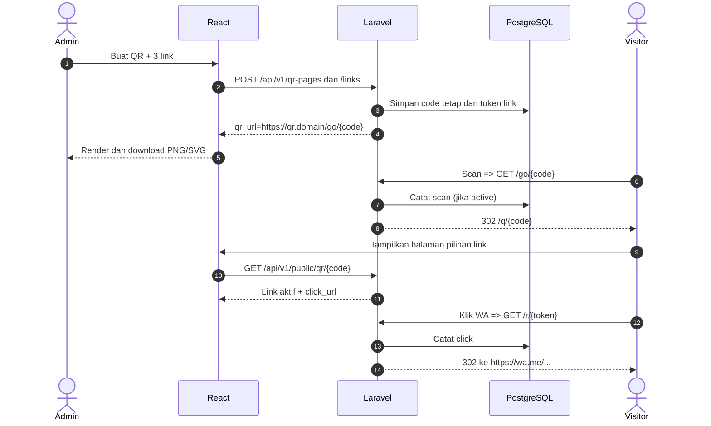

# BE.md — Backend QR Multi-Link Generator (Laravel 13)

> Blueprint backend REST API **Laravel 13 + PostgreSQL + Sanctum** untuk produk **1 QR → banyak link**. Cocok dengan [`STARTER.md`](./STARTER.md) dan kontrak frontend [`FE.md`](./FE.md). **Bukan** modul pencetakan tiket/kartu dan tidak memiliki editor desain.

## 1. Prinsip arsitektur

Backend bertanggung jawab atas:

1. Login/logout admin via **Sanctum stateful SPA cookie** (bukan token localStorage).
2. CRUD QR milik masing-masing user dan CRUD/urutan link di dalam QR.
3. Pembuatan `code` unik **immutable** untuk tiap QR dan `token` unik **immutable** untuk tiap link.
4. URL QR permanen yang tidak berubah ketika judul atau alamat link diedit.
5. URL resolver scan `GET /go/{code}`: catat kunjungan dan **302** ke frontend `/q/{code}`.
6. URL resolver klik `GET /r/{token}`: catat klik dan **302** ke target HTTPS terbaru yang tersimpan.
7. API publik untuk halaman multi-link yang **tidak membocorkan URL tujuan mentah atau data admin**.
8. Statistik lifetime, harian, dan per-link; validasi input, authorization, throttle, soft-delete, dan audit dasar.

### Arsitektur request



## 2. Teknologi dan requirement

| Komponen | Implementasi |
|---|---|
| Framework | Laravel **13** (Composer project constraint `^13.0`) |
| PHP | Ikuti `composer.json` Laravel 13 yang diinstal; siapkan PHP modern dan ekstensi `pdo_pgsql`, OpenSSL, Mbstring, XML, Ctype, JSON, Tokenizer |
| Database | PostgreSQL 15+ |
| ORM | Eloquent ORM + migrations + policy |
| Auth | Laravel Sanctum, session cookie untuk SPA |
| Validasi | FormRequest + custom validation rule |
| API | JSON Resources, pagination, HTTP status konsisten |
| Analytics | PostgreSQL event table, cached anti-duplikasi opsional |
| Queue/Cache | Database atau Redis; Redis direkomendasikan bila trafik tinggi |
| Tests | PHPUnit via `php artisan test` |

**Catatan versi:** ketersediaan paket Laravel 13 dan batas minimal PHP perlu diverifikasi di lingkungan instalasi menggunakan Composer; spesifikasi ini tidak mengunci versi patch yang dapat berubah. Jangan gunakan `--ignore-platform-reqs` untuk deployment.

## 3. Instalasi backend dari nol

Di root proyek:

```bash
composer create-project laravel/laravel backend "^13.0"
cd backend
php artisan install:api
php artisan key:generate
```

`install:api` menyiapkan rute API/Sanctum pada instalasi Laravel modern. Periksa `bootstrap/app.php` setelah perintah dijalankan.

### Database PostgreSQL

```sql
CREATE USER qr_app WITH PASSWORD 'ganti_password_kuat';
CREATE DATABASE qr_multilink OWNER qr_app;
```

### `backend/.env.example` (contoh tanpa password sungguhan)

```dotenv
APP_NAME="QR Multi-Link"
APP_ENV=local
APP_KEY=
APP_DEBUG=true
APP_URL=http://localhost:8000

DB_CONNECTION=pgsql
DB_HOST=127.0.0.1
DB_PORT=5432
DB_DATABASE=qr_multilink
DB_USERNAME=qr_app
DB_PASSWORD=ubah_sesuai_local

SESSION_DRIVER=database
SESSION_DOMAIN=null
SESSION_SECURE_COOKIE=false
SANCTUM_STATEFUL_DOMAINS=localhost:5173,localhost:8000

# Domain browser yang digunakan membuka QR. Perlu HTTPS di produksi.
PUBLIC_BASE_URL=http://localhost:5173
FRONTEND_URL=http://localhost:5173

QR_MAX_LINKS=20
QR_EVENT_RETENTION_DAYS=90
# Key acak panjang, terpisah dari APP_KEY; jangan ditaruh di frontend.
QR_ANALYTICS_HASH_KEY=isi_dengan_secret_acak_panjang
```

Jalankan `php artisan migrate` sesudah migrasi kustom dibuat. Jangan commit `.env`, akun database, atau APP_KEY. Laravel 13 dapat menyediakan pilihan default cache/queue yang berbeda antar template; pilih secara eksplisit bila diperlukan.

### Konfigurasi `config/qr.php` (file kustom yang harus dibuat)

```php
<?php

return [
    'public_base_url' => rtrim(env('PUBLIC_BASE_URL', 'http://localhost:5173'), '/'),
    'frontend_url' => rtrim(env('FRONTEND_URL', 'http://localhost:5173'), '/'),
    'max_links' => (int) env('QR_MAX_LINKS', 20),
    'event_retention_days' => (int) env('QR_EVENT_RETENTION_DAYS', 90),
    'analytics_hash_key' => env('QR_ANALYTICS_HASH_KEY'),
];
```

Pakai `config('qr.public_base_url')` di application code; **jangan memanggil `env()` dari controller**, karena konfigurasi akan di-cache pada produksi.

## 4. Struktur backend target

```text
backend/
├── app/
│   ├── Console/Commands/
│   │   ├── CreateQrAdmin.php
│   │   └── PruneQrEvents.php
│   ├── Http/
│   │   ├── Controllers/Api/V1/
│   │   │   ├── AuthController.php
│   │   │   ├── QrPageController.php
│   │   │   ├── QrLinkController.php
│   │   │   ├── QrStatsController.php
│   │   │   └── PublicQrController.php
│   │   ├── Controllers/
│   │   │   └── QrRedirectController.php
│   │   ├── Requests/
│   │   │   ├── LoginRequest.php
│   │   │   ├── StoreQrPageRequest.php
│   │   │   ├── UpdateQrPageRequest.php
│   │   │   ├── StoreQrLinkRequest.php
│   │   │   ├── UpdateQrLinkRequest.php
│   │   │   └── ReorderQrLinksRequest.php
│   │   └── Resources/
│   │       ├── QrPageResource.php
│   │       ├── QrLinkResource.php
│   │       └── PublicQrPageResource.php
│   ├── Models/
│   │   ├── QrPage.php
│   │   ├── QrLink.php
│   │   └── QrEvent.php
│   ├── Policies/QrPagePolicy.php
│   ├── Rules/PublicHttpsUrl.php
│   └── Services/
│       ├── QrPageService.php
│       ├── QrLinkService.php
│       ├── QrRedirectService.php
│       └── QrStatsService.php
├── bootstrap/app.php
├── config/qr.php
├── database/
│   ├── migrations/*create_qr_pages_table.php
│   ├── migrations/*create_qr_links_table.php
│   ├── migrations/*create_qr_events_table.php
│   ├── seeders/DatabaseSeeder.php
│   └── factories/
├── routes/
│   ├── api.php
│   ├── web.php
│   └── console.php
├── tests/Feature/
│   ├── AuthTest.php
│   ├── QrPageTest.php
│   ├── QrLinkTest.php
│   ├── QrRedirectTest.php
│   └── QrStatsTest.php
└── .env.example
```

## 5. Desain database

### 5.1 `users` (Laravel default)

Gunakan tabel `users` bawaan Laravel dengan PK bigint. Semua akun dibuat admin/operator melalui command server, **tidak tersedia registrasi publik**. Setiap user hanya dapat mengakses QR miliknya.

### 5.2 `qr_pages`

| Kolom | Tipe | Aturan |
|---|---|---|
| `id` | ULID PK | ID internal untuk API admin |
| `user_id` | foreignId → users | Owner wajib |
| `code` | varchar(16) unique | Acak 12 karakter, immutable |
| `title` | varchar(120) | Wajib |
| `description` | text nullable | Maks. 500 karakter |
| `status` | varchar(16) | `draft`, `active`, `paused` |
| `total_scans` | unsigned big integer | Default 0 |
| `total_clicks` | unsigned big integer | Default 0 |
| `created_at`, `updated_at` | timestamp | Standar Laravel |
| `deleted_at` | timestamp nullable | SoftDeletes |

Indeks: `unique(code)`, `(user_id, created_at)`, `(user_id, status)`. **Code tidak boleh dipakai ulang**, termasuk setelah soft delete.

### 5.3 `qr_links`

| Kolom | Tipe | Aturan |
|---|---|---|
| `id` | ULID PK | ID internal link |
| `qr_page_id` | foreignUlid → qr_pages | Induk wajib |
| `token` | varchar(32) unique | Acak 24 karakter, immutable |
| `label` | varchar(80) | Teks tombol |
| `icon_key` | varchar(24) | Enum ikon yang diizinkan |
| `destination_url` | text | HTTPS valid, max 2048 |
| `sort_order` | small integer | Default 0 |
| `is_active` | boolean | Default true |
| `total_clicks` | unsigned big integer | Default 0 |
| `created_at`, `updated_at` | timestamp | Standar Laravel |
| `deleted_at` | timestamp nullable | SoftDeletes |

Indeks: `unique(token)`, `(qr_page_id, sort_order)`, `(qr_page_id, is_active)`. Maks. 20 **link yang belum dihapus** per QR untuk MVP.

### 5.4 `qr_events`

| Kolom | Tipe | Aturan |
|---|---|---|
| `id` | bigIncrements | Primary key |
| `qr_page_id` | foreignUlid → qr_pages | QR induk |
| `qr_link_id` | nullable foreignUlid → qr_links | Hanya untuk klik |
| `type` | varchar(8) | `scan` atau `click` |
| `visitor_key` | char(64) nullable | HMAC terpotong/hex, bukan IP mentah |
| `created_at` | timestamp | Waktu event UTC |

`qr_events` **tidak memerlukan `updated_at`**. Indeks `(qr_page_id, type, created_at)`, `(qr_link_id, type, created_at)`. Event scan: `qr_link_id = null`. Event click: `qr_link_id` berisi ID link.

**Statistik lifetime** tersimpan di `qr_pages.total_scans` dan `total_clicks`, serta `qr_links.total_clicks`; data event digunakan untuk rentang tanggal dan boleh dipangkas setelah 90 hari. Ini berarti grafik 90 hari tersedia, tetapi riwayat harian di luar retensi tidak lengkap; lifetime tetap ada.

### 5.5 Migrasi dasar (implementasi yang disarankan)

`database/migrations/...create_qr_pages_table.php`:

```php
Schema::create('qr_pages', function (Blueprint $table) {
    $table->ulid('id')->primary();
    $table->foreignId('user_id')->constrained()->cascadeOnDelete();
    $table->string('code', 16)->unique();
    $table->string('title', 120);
    $table->text('description')->nullable();
    $table->string('status', 16)->default('draft');
    $table->unsignedBigInteger('total_scans')->default(0);
    $table->unsignedBigInteger('total_clicks')->default(0);
    $table->timestamps();
    $table->softDeletes();
    $table->index(['user_id', 'created_at']);
    $table->index(['user_id', 'status']);
});
```

`database/migrations/...create_qr_links_table.php`:

```php
Schema::create('qr_links', function (Blueprint $table) {
    $table->ulid('id')->primary();
    $table->foreignUlid('qr_page_id')->constrained('qr_pages')->cascadeOnDelete();
    $table->string('token', 32)->unique();
    $table->string('label', 80);
    $table->string('icon_key', 24)->default('website');
    $table->text('destination_url');
    $table->unsignedSmallInteger('sort_order')->default(0);
    $table->boolean('is_active')->default(true);
    $table->unsignedBigInteger('total_clicks')->default(0);
    $table->timestamps();
    $table->softDeletes();
    $table->index(['qr_page_id', 'sort_order']);
    $table->index(['qr_page_id', 'is_active']);
});
```

`database/migrations/...create_qr_events_table.php`:

```php
Schema::create('qr_events', function (Blueprint $table) {
    $table->id();
    $table->foreignUlid('qr_page_id')->constrained('qr_pages')->cascadeOnDelete();
    $table->foreignUlid('qr_link_id')->nullable()
        ->constrained('qr_links')->nullOnDelete();
    $table->string('type', 8);
    $table->char('visitor_key', 64)->nullable();
    $table->timestamp('created_at')->useCurrent();
    $table->index(['qr_page_id', 'type', 'created_at']);
    $table->index(['qr_link_id', 'type', 'created_at']);
});
```

**Penting:** migration snippets membutuhkan `use Illuminate\Database\Schema\Blueprint;` dan `use Illuminate\Support\Facades\Schema;` pada file migration Laravel masing-masing. Urutan migrasi: `qr_pages` → `qr_links` → `qr_events`. Soft deleted QR/link tidak langsung menghapus histori. Hard delete harus memperhatikan relasi statistik.

## 6. Eloquent model dan relasi

```php
// App\Models\QrPage (potongan)
use Illuminate\Database\Eloquent\Concerns\HasUlids;
use Illuminate\Database\Eloquent\SoftDeletes;

class QrPage extends Model
{
    use HasUlids, SoftDeletes;

    protected $fillable = ['title', 'description', 'status'];

    public function user() { return $this->belongsTo(User::class); }
    public function links() { return $this->hasMany(QrLink::class); }
    public function events() { return $this->hasMany(QrEvent::class); }
}

// App\Models\QrLink (potongan)
class QrLink extends Model
{
    use HasUlids, SoftDeletes;

    protected $fillable = [
        'label', 'icon_key', 'destination_url', 'sort_order', 'is_active',
    ];

    protected function casts(): array
    {
        return ['is_active' => 'boolean'];
    }

    public function qrPage() { return $this->belongsTo(QrPage::class); }
}
```

`id`, `code`, `token`, `user_id`, hit counter, `qr_page_id` **jangan** mass-assign melalui `$request->all()`. Tetapkan server-side ketika membuat record. `QrPage` dan `QrLink` gunakan model `HasUlids`; `QrEvent` memakai incrementing integer ID dan harus menetapkan `public $timestamps = false;` karena tabel event hanya memiliki `created_at`. Ketika membuat event secara manual, isi `created_at` dengan waktu UTC (`now()`) atau biarkan default database mengisinya.

## 7. Auth Laravel Sanctum (cookie SPA)

### Aktivasi middleware stateful

Pastikan `bootstrap/app.php` mengaktifkan stateful API pada konfigurasi middleware:

```php
->withMiddleware(function (Middleware $middleware): void {
    $middleware->statefulApi();
})
```

Ini potongan konfigurasi, bukan keseluruhan `bootstrap/app.php`. Route `api.php` memakai group prefix `v1`, dan seluruh endpoint privat memakai `auth:sanctum`.

**Login** (`POST /api/v1/auth/login`):

1. Validasi email/password; rate limit maksimal 5 percobaan per menit per kombinasi email+IP.
2. `Auth::attempt($credentials)`; bila gagal balas HTTP `422`/`401` konsisten.
3. Regenerate session: `$request->session()->regenerate()`.
4. Return `{ "data": { "id", "name", "email" } }`.

**Logout:** `Auth::guard('web')->logout()`, invalidate session, regenerate CSRF token. Semua sesi browser tergantung cookie ber-HttpOnly, Secure di HTTPS, dan SameSite; jangan menyimpan JWT/token pengguna di frontend.

### CORS dan session

Pada mode **satu origin dengan Vite proxy**, browser mengakses `localhost:5173` untuk React, `/api/*`, dan `/sanctum/*`, sehingga CORS silang-origin tidak diperlukan. Jika memisahkan origin FE/BE, atur `config/cors.php` secara terbatas (`supports_credentials = true`, origin persis), `SANCTUM_STATEFUL_DOMAINS`, domain cookie dan HTTPS; jangan menggunakan wildcard origin untuk request dengan credential.

Gunakan hostname konsisten. Jika browser memakai `localhost:5173`, **jangan campur request** ke `127.0.0.1:8000` dari JavaScript karena bisa gagal cookie/CSRF.

## 8. Aturan bisnis wajib

### QR Page

- QR baru berstatus `draft`; `code` dibuat backend panjang 12 karakter acak alfanumerik, dengan unique index dan retry ketika collision.
- `code` **immutable** selamanya; tidak dapat diedit dari API.
- Saat mengubah ke `active`, wajib mempunyai **minimal 1 link aktif yang tidak terhapus**.
- Saat di-`paused`, halaman publik menampilkan tidak tersedia; link redirect berhenti.
- Menghapus QR = `softDelete`, QR lama tidak dapat digunakan lagi. UI harus mengonfirmasi.
- Owner harus sesuai `auth()->id()` untuk semua operasi privat. Akses terhadap ID QR milik user lain sebaiknya dibalas `404` untuk mencegah enumerasi.

### Link

- Satu QR boleh memiliki 0–20 link saat draft, minimal 1 link aktif ketika QR `active`.
- Link memiliki `token` 24 karakter acak, **immutable** walaupun `destination_url` diedit.
- Edit URL tujuan segera memengaruhi redirect `/r/{token}` berikutnya. Tidak perlu download QR ulang.
- Menonaktifkan atau menghapus **link aktif terakhir** saat QR sedang `active` harus ditolak `422`; admin dapat menjeda QR terlebih dahulu.
- Semua mutasi link harus memverifikasi `link.qr_page_id === page.id`, bukan hanya `link.id`.
- Reorder harus mengandung **persis semua ID link yang belum dihapus** milik QR tersebut (tidak duplikat, tidak lintas-user), lalu set `sort_order` mulai 0.
- Perubahan yang memengaruhi jumlah link aktif dibungkus dalam `DB::transaction` dan lock row QR induk untuk menghindari race condition.
- Menambah link ke QR aktif diperbolehkan selama tidak melebihi batas; mengganti teks dan URL link tidak mengubah QR.

### URL tujuan yang boleh digunakan

- Hanya `https://` dengan hostname publik yang valid; maksimal 2048 karakter.
- Tolak `http:`, `javascript:`, `data:`, `file:`, `ftp:`, relative URLs, URL dengan `username:password@host`, dan hostname `localhost`, `.local`, `.internal`, atau IP private/loopback/reserved.
- URL default yang valid, misalnya:
  - WhatsApp: `https://wa.me/6281234567890`
  - Instagram: `https://www.instagram.com/username`
  - TikTok: `https://www.tiktok.com/@username`
  - Website: `https://example.com`
- Jangan memaksa host WA/IG jika `icon_key` memakai label tersebut, kecuali ingin menerapkan kebijakan allowlist lebih ketat. Semua tujuan HTTPS tetap melewati validasi keamanan.
- Backend **tidak melakukan fetch ke destination_url**. Hal ini mengurangi risiko SSRF. Validasi host/IP literal tetap penting untuk menghindari redirect ke alamat internal atau localhost.

## 9. URL dan HTTP routing

### `routes/api.php`

Semua `/api/v1/...` otomatis menerima prefix `/api` dari Laravel; jangan menambah `/api` lagi secara manual di file ini.

```php
use App\Http\Controllers\Api\V1\AuthController;
use App\Http\Controllers\Api\V1\QrPageController;
use App\Http\Controllers\Api\V1\QrLinkController;
use App\Http\Controllers\Api\V1\QrStatsController;
use App\Http\Controllers\Api\V1\PublicQrController;
use Illuminate\Support\Facades\Route;

Route::prefix('v1')->group(function () {
    Route::get('/public/qr/{code}', [PublicQrController::class, 'show'])
        ->middleware('throttle:120,1');

    Route::post('/auth/login', [AuthController::class, 'login'])
        ->middleware('throttle:5,1');

    Route::middleware('auth:sanctum')->group(function () {
        Route::get('/auth/me', [AuthController::class, 'me']);
        Route::post('/auth/logout', [AuthController::class, 'logout']);

        Route::get('/qr-pages', [QrPageController::class, 'index']);
        Route::post('/qr-pages', [QrPageController::class, 'store']);
        Route::get('/qr-pages/{qrPage}', [QrPageController::class, 'show']);
        Route::patch('/qr-pages/{qrPage}', [QrPageController::class, 'update']);
        Route::delete('/qr-pages/{qrPage}', [QrPageController::class, 'destroy']);
        Route::get('/qr-pages/{qrPage}/stats', [QrStatsController::class, 'show']);

        Route::put('/qr-pages/{qrPage}/links/reorder',
            [QrLinkController::class, 'reorder']);
        Route::post('/qr-pages/{qrPage}/links', [QrLinkController::class, 'store']);
        Route::patch('/qr-pages/{qrPage}/links/{link}',
            [QrLinkController::class, 'update'])->scopeBindings();
        Route::delete('/qr-pages/{qrPage}/links/{link}',
            [QrLinkController::class, 'destroy'])->scopeBindings();
    });
});
```

`scopeBindings()` memastikan parameter `{link}` dimuat melalui relasi `QrPage::links()` untuk route nested. Tetap lakukan authorization owner QR melalui policy.

### `routes/web.php`

```php
use App\Http\Controllers\QrRedirectController;
use Illuminate\Support\Facades\Route;

Route::get('/go/{code}', [QrRedirectController::class, 'scan'])
    ->name('qr.scan')
    ->middleware('throttle:120,1');

Route::get('/r/{token}', [QrRedirectController::class, 'click'])
    ->name('qr.click')
    ->middleware('throttle:120,1');
```

Rate limit bersifat contoh awal; tingkatkan atau ubah sesuai volume scan pada event besar. Gunakan satu `PUBLIC_BASE_URL` yang browser dapat akses untuk QR dan click URL. Endpoint GET resolver harus mengirim `Cache-Control: no-store` supaya redirect tidak tersimpan lama oleh browser/proxy.

## 10. Spesifikasi endpoint JSON

Semua error JSON API (`Accept: application/json`) memakai bentuk konsisten:

```json
{
  "message": "The given data was invalid.",
  "errors": {
    "destination_url": ["Gunakan URL HTTPS publik yang valid."]
  }
}
```

### 10.1 Login dan session

**POST** `/api/v1/auth/login`

```json
{ "email": "admin@example.com", "password": "password_rahasia" }
```

**200**:

```json
{ "data": { "id": 1, "name": "Admin QR", "email": "admin@example.com" } }
```

- `GET /api/v1/auth/me` → 200 user atau 401.
- `POST /api/v1/auth/logout` → 204 No Content.
- Cookie CSRF diinisialisasi dengan `GET /sanctum/csrf-cookie` (bukan route API v1).

### 10.2 Create QR

**POST** `/api/v1/qr-pages`

```json
{
  "title": "Media Sosial Kami",
  "description": "Pilih kanal yang ingin Anda kunjungi"
}
```

**201**:

```json
{
  "data": {
    "id": "01JABCDEFGHJKMNPQRSTVWXYZ0",
    "code": "8Xv4qBp7Jn2K",
    "title": "Media Sosial Kami",
    "description": "Pilih kanal yang ingin Anda kunjungi",
    "status": "draft",
    "qr_url": "https://qr.domain.com/go/8Xv4qBp7Jn2K",
    "total_scans": 0,
    "total_clicks": 0,
    "links": [],
    "created_at": "2026-10-27T06:00:00Z",
    "updated_at": "2026-10-27T06:00:00Z"
  }
}
```

Domain/id di atas **contoh**, bukan nilai nyata. Dalam development respons `qr_url` memakai `PUBLIC_BASE_URL=http://localhost:5173`.

### 10.3 List, detail, update, delete QR

**GET** `/api/v1/qr-pages?search=media&page=1&per_page=10`

```json
{
  "data": [
    {
      "id": "01JABCDEFGHJKMNPQRSTVWXYZ0",
      "code": "8Xv4qBp7Jn2K",
      "title": "Media Sosial Kami",
      "description": "Pilih kanal yang ingin Anda kunjungi",
      "status": "active",
      "qr_url": "https://qr.domain.com/go/8Xv4qBp7Jn2K",
      "total_scans": 18,
      "total_clicks": 11,
      "links": [],
      "created_at": "2026-10-27T06:00:00Z",
      "updated_at": "2026-10-27T06:30:00Z"
    }
  ],
  "meta": { "current_page": 1, "last_page": 1, "per_page": 10, "total": 1 },
  "links": { "first": "...", "last": "...", "prev": null, "next": null }
}
```

Untuk daftar, `links: []` di dalam item dapat dikosongkan agar ringan; **pada detail**, `links` diisi lengkap. Jika UI daftar menampilkan jumlah link aktif, tambahkan `active_links_count` via `withCount` dan dokumentasikan di frontend; jangan kirim semua URL tautan untuk daftar.

**GET** `/api/v1/qr-pages/{id}` → `200 {"data": QrPage}` lengkap dengan admin links.

**PATCH** `/api/v1/qr-pages/{id}`:

```json
{ "title": "Kontak Resmi Kami", "status": "active" }
```

- Field yang boleh diubah: `title`, `description`, `status`.
- Tidak boleh mengubah `code`, `id`, `qr_url`, `user_id` atau counters.
- Perubahan status ke `active` tanpa tautan aktif → 422.
- Success: 200 `{ "data": QrPage }`.

**DELETE** `/api/v1/qr-pages/{id}` → 204, soft-delete.

### 10.4 Create/edit/delete/reorder link

**POST** `/api/v1/qr-pages/{id}/links`:

```json
{
  "label": "WhatsApp",
  "icon_key": "whatsapp",
  "destination_url": "https://wa.me/6281234567890",
  "is_active": true
}
```

**201**:

```json
{
  "data": {
    "id": "01JLINKABCDEFGHJKMNPQRSTV0",
    "token": "Q93sLf2zM80N4hX7vk1ARbPc",
    "label": "WhatsApp",
    "icon_key": "whatsapp",
    "destination_url": "https://wa.me/6281234567890",
    "click_url": "https://qr.domain.com/r/Q93sLf2zM80N4hX7vk1ARbPc",
    "sort_order": 0,
    "is_active": true,
    "total_clicks": 0
  }
}
```

**PATCH** `/api/v1/qr-pages/{id}/links/{linkId}`:

```json
{
  "label": "Chat Admin WhatsApp",
  "destination_url": "https://wa.me/6289876543210",
  "is_active": true
}
```

- 200 `{ "data": QrLink }`, `token` tidak berubah.
- **DELETE** `/api/v1/qr-pages/{id}/links/{linkId}` → 204, soft-delete.
- Nonaktifkan/hapus link aktif terakhir dari QR yang `active` → 422.

**PUT** `/api/v1/qr-pages/{id}/links/reorder`:

```json
{ "ids": ["01JLINKAAA...", "01JLINKBBB...", "01JLINKCCC..."] }
```

Hanya diterima jika array berisi semua ID link belum terhapus pada halaman tepat satu kali. Respons 200 `{ "data": [QrLink, ...] }` terurut.

### 10.5 Publik halaman multi-link

**GET** `/api/v1/public/qr/{code}` → 200 hanya jika QR `active` dan tidak terhapus:

```json
{
  "data": {
    "code": "8Xv4qBp7Jn2K",
    "title": "Media Sosial Kami",
    "description": "Pilih kanal yang ingin Anda kunjungi",
    "links": [
      {
        "label": "WhatsApp",
        "icon_key": "whatsapp",
        "click_url": "https://qr.domain.com/r/Q93sLf2zM80N4hX7vk1ARbPc",
        "sort_order": 0
      },
      {
        "label": "Instagram",
        "icon_key": "instagram",
        "click_url": "https://qr.domain.com/r/PGbLq84m5RpaWFbGk61xhZd2",
        "sort_order": 1
      }
    ]
  }
}
```

- Tidak ada `destination_url`, `token` terpisah, owner, email, data privat, atau statistik.
- Untuk QR `draft`/`paused` → **410 Gone**, tidak menampilkan link aktif.
- Untuk `code` tidak ada atau sudah soft-deleted → **404 Not Found**.
- API baca halaman publik **tidak menaikkan angka scan** (agar reload halaman tidak dihitung sebagai scan QR baru).
- `Cache-Control: no-store` atau kebijakan revalidasi ketat agar perubahan link cepat terlihat.

### 10.6 URL resolver scanner dan klik

**GET** `/go/{code}`:

| Kondisi | Respons |
|---|---|
| QR `active` | Catat event `scan` + increment counter, **302** ke `PUBLIC_BASE_URL/q/{code}` |
| QR `draft` / `paused` | **302** ke `/q/{code}` tanpa mencatat scan; API publik menghasilkan 410 |
| Tidak ditemukan / soft delete | **404** |

**GET** `/r/{token}`:

| Kondisi | Respons |
|---|---|
| Link aktif + QR aktif | Catat event `click` + increment kedua counter, **302** ke `destination_url` terkini |
| Link atau QR nonaktif | **410 Gone** |
| Token tidak ditemukan / soft delete | **404** |

Kedua resolver mengirim `Cache-Control: no-store`, `X-Robots-Tag: noindex, nofollow`, dan pada redirect keluar tambahkan `Referrer-Policy: no-referrer`. JANGAN menerima parameter `?url=...` sebagai tujuan redirect; target selalu diambil dari DB milik token yang valid.

### 10.7 Statistik

**GET** `/api/v1/qr-pages/{id}/stats?period=7d` (`7d`, `30d`, `90d`)

```json
{
  "data": {
    "period": "7d",
    "total_scans": 120,
    "total_clicks": 82,
    "period_scans": 18,
    "period_clicks": 11,
    "daily": [
      { "date": "2026-10-26", "scans": 8, "clicks": 5 },
      { "date": "2026-10-27", "scans": 10, "clicks": 6 }
    ],
    "links": [
      { "id": "01JLINKABCDEFGHJKMNPQRSTV0", "label": "WhatsApp", "clicks": 7 },
      { "id": "01JLINKABCDEFGHJKMNPQRSTV1", "label": "Instagram", "clicks": 4 }
    ]
  }
}
```

- Lifetime dari counter; `period_*` dari event dalam rentang UTC; `daily` berisi seluruh tanggal pada rentang (isi nol jika tidak ada hit).
- Klik per link hanya dihitung pada rentang periode; bisa tampilkan link terhapus (soft-delete) untuk menjaga konsistensi histori, beri label sesuai record tersimpan.
- Periode `7d` berarti hari ini + 6 hari sebelumnya (UTC); demikian pula 30/90 hari.
- Query statistik selalu dibatasi ke QR milik auth user.

## 11. Implementasi controller/service penting

### 11.1 URL builder tunggal

Tulis helper di `QrPageService` atau service URL khusus:

```php
public function qrUrl(QrPage $page): string
{
    return config('qr.public_base_url') . '/go/' . rawurlencode($page->code);
}

public function clickUrl(QrLink $link): string
{
    return config('qr.public_base_url') . '/r/' . rawurlencode($link->token);
}

public function landingUrl(QrPage $page): string
{
    return config('qr.frontend_url') . '/q/' . rawurlencode($page->code);
}
```

Tidak ada route download image di backend untuk MVP; `qr_url` diserahkan ke generator PNG/SVG di React.

### 11.2 Membuat code/token

```php
use Illuminate\Support\Str;

$code = Str::random(12);   // unik per QR (cegah collision via unique DB)
$token = Str::random(24);  // unik per link
```

`unique()` pada database adalah perlindungan akhir. Saat duplicate-key exception khusus index tersebut, buat random baru dan retry terbatas (mis. 5 percobaan). Jangan menangkap semua exception DB lalu menganggapnya collision. `code` dan `token` jangan diubah setelah dibuat.

### 11.3 Transaksi untuk QR aktif dan link terakhir

**Aktivasi QR:**

```text
DB::transaction:
  Lock qr_pages row FOR UPDATE
  Pastikan qr_page.user_id == auth user
  Hitung qr_links aktif non-deleted
  Jika jumlah < 1, return validation error 422
  Update qr_pages.status = 'active'
```

**Nonaktifkan/hapus link:**

```text
DB::transaction:
  Lock qr_pages row FOR UPDATE
  Load link milik halaman (scope parent)
  Jika QR active dan link yang diubah adalah satu-satunya link aktif:
    Tolak 422 (minta jeda QR terlebih dahulu)
  Jika valid, update/delete link
```

**Menambah link:** lock QR induk, hitung link non-deleted, tolak jumlah >=20, simpan `sort_order = max(sort_order)+1`. Gunakan pola lock konsisten untuk menghindari dua request paralel melewati batas.

### 11.4 Resolver redirect

Pseudocode untuk controller `QrRedirectController`:

```php
public function scan(string $code, Request $request)
{
    $page = QrPage::query()->where('code', $code)->firstOrFail();

    if ($page->status === 'active') {
        app(QrRedirectService::class)->recordScan($page, $request);
    }

    $response = redirect()->away(
        app(QrPageService::class)->landingUrl($page), 302
    );
    $response->headers->set('Cache-Control', 'no-store');
    $response->headers->set('X-Robots-Tag', 'noindex, nofollow');
    return $response;
}

public function click(string $token, Request $request)
{
    $link = QrLink::query()->with('qrPage')
        ->where('token', $token)->firstOrFail();

    abort_unless($link->qrPage && $link->qrPage->status === 'active'
        && $link->is_active, 410);

    app(QrRedirectService::class)->recordClick($link, $request);

    $response = redirect()->away($link->destination_url, 302);
    $response->headers->set('Cache-Control', 'no-store');
    $response->headers->set('X-Robots-Tag', 'noindex, nofollow');
    $response->headers->set('Referrer-Policy', 'no-referrer');
    return $response;
}
```

Ini **kerangka logika**, bukan file controller lengkap. Pada implementasi produksi, gunakan transaksi/locking/anti-duplikasi dan penanganan konsistensi status sebagaimana dijelaskan di bawah; jangan hanya menyalin pseudocode dan menganggap sudah aman terhadap race condition.

### 11.5 Event tracking dan hit counter

- Rekam satu event untuk hit yang lolos aturan anti-duplikasi (jika diaktifkan).
- Counter `qr_pages.total_scans`, `qr_pages.total_clicks`, dan `qr_links.total_clicks` bertambah atomik via `increment()` **dalam transaksi yang sama** dengan insert event; jika event gagal, counter tidak bertambah.
- `visitor_key` opsional: `hash_hmac('sha256', IP + '|' + UserAgent + '|' + UTCdate, secret)`; simpan hash HMAC **saja**, jangan IP/user-agent mentah.
- Hindari log mentah dari reverse proxy jika tidak diperlukan; atur kebijakan retensi dan akses log terpisah.
- Gunakan `Cache::add('qr:scan:' . $page->id . ':' . $hash, true, 10)` untuk anti-duplikasi 10 detik **secara opsional**. Trade-off: pengguna di jaringan/perangkat sama dapat terhitung satu, sehingga ini hit yang diperkirakan, bukan jumlah pengguna unik.
- Penanganan prefetch dan bot perlu heuristik (`HEAD`, crawler user agents) dan/atau header `Purpose: prefetch`, dengan caveat deteksi bot tidak sempurna.
- Jangan mengklaim angka sebagai "jumlah scan kamera sesungguhnya".
- Bila jumlah scan sangat besar, pisahkan analytics write path ke queue/atomic counter dengan desain idempotensi yang konsisten; MVP cukup transaksi database.

**Race condition tambahan:** resolver yang sedang mencatat klik bersamaan dengan perubahan status bisa mengalami perubahan link. Jika dibutuhkan konsistensi kuat, re-read & lock parent dan link dalam urutan sama sebelum menentukan apakah klik dicatat dan URL akhir dipakai untuk redirect.

## 12. FormRequest validation

### `StoreQrPageRequest`

```php
return [
    'title' => ['required', 'string', 'min:3', 'max:120'],
    'description' => ['nullable', 'string', 'max:500'],
];
```

### `UpdateQrPageRequest`

```php
return [
    'title' => ['sometimes', 'required', 'string', 'min:3', 'max:120'],
    'description' => ['sometimes', 'nullable', 'string', 'max:500'],
    'status' => ['sometimes', 'required', Rule::in(['draft', 'active', 'paused'])],
];
```

### `StoreQrLinkRequest` / `UpdateQrLinkRequest`

```php
return [
    'label' => ['required', 'string', 'min:1', 'max:80'],
    'icon_key' => ['required', Rule::in([
        'whatsapp', 'instagram', 'tiktok', 'facebook',
        'youtube', 'website', 'custom',
    ])],
    'destination_url' => ['required', 'string', 'max:2048', new PublicHttpsUrl],
    'is_active' => ['required', 'boolean'],
];
```

Untuk **PATCH**, ganti `required` menjadi `sometimes|required` (dan tetap gunakan custom validator). Pastikan rule menghapus whitespace pinggir melalui normalisasi yang aman; URL tujuan tidak boleh diubah secara diam-diam (mis. menambahkan `https` tanpa izin). `ReorderQrLinksRequest`: `ids` array, `ids.*` ULID, `distinct`, jumlah dan keanggotaan diverifikasi terhadap database secara atomik.

### `PublicHttpsUrl` (custom validator)

- Gunakan `filter_var($value, FILTER_VALIDATE_URL)` dan `parse_url` / `Uri` library yang disetujui, harus memiliki `scheme=https` serta hostname.
- Normalisasikan hostname (IDN/punycode jika didukung) sebelum validasi host.
- Reject `user`/`pass`, `localhost`, localhost subdomain, `.local`, `.internal`, literal IPv4/IPv6 nonpublik dan port tidak wajar menurut kebijakan.
- Tolak newline/control characters, fragment URL yang berbahaya jika kebijakan mewajibkan.
- Tidak perlu melakukan HTTP request ke host; aturan hanya memvalidasi string redirect dan mencegah tujuan jelas tidak aman. **Redirect HTTPS masih mungkin mengarah ke domain phishing** — mitigasi dengan admin-only dan opsi allowlist domain bila dipakai untuk publik luas.
- Tambahkan unit test untuk URL WhatsApp, IG, TikTok, website, invalid schemes, userinfo, private address, IPv6, international domains.

## 13. Policy dan kepemilikan

`QrPagePolicy`:

```php
public function view(User $user, QrPage $page): bool
{
    return $page->user_id === $user->id;
}

public function update(User $user, QrPage $page): bool
{
    return $page->user_id === $user->id;
}

public function delete(User $user, QrPage $page): bool
{
    return $page->user_id === $user->id;
}
```

- `index`: query `QrPage::where('user_id', $request->user()->id)`; jangan mengambil semua QR dahulu lalu filter di React.
- `show/update/delete/stats`: panggil policy `Gate::authorize(...)` / `$this->authorize(...)` dan scoping owner; bila ingin 404 untuk resource milik orang lain, scope query sejak route binding/resolution atau lakukan `firstOrFail` pada query `where(user_id, ...)`.
- Link child harus selalu dibatasi pada `qr_page_id` yang sudah lolos authorization, termasuk pada reorder.
- Tidak ada endpoint create QR tanpa sesi; public QR hanya read-only.

## 14. Pembuatan admin pertama

Buat command `php artisan qr:create-admin` menggunakan `php artisan make:command CreateQrAdmin`:

1. Meminta `name`, `email`, `password` lewat terminal (password hidden).
2. Validasi format email dan password kuat (minimal 12 karakter dianjurkan).
3. Periksa keunikan email; `Hash::make($password)`.
4. Simpan User ke tabel `users`, cetak hanya email/name, **jangan tampilkan password lagi**.
5. Command idempoten: email yang sudah ada tidak dibuat dua kali.

Command ini **harus diimplementasikan**, bukan perintah Laravel bawaan.

## 15. Retensi event dan jadwal pemeliharaan

- Buat command `qr:prune-events` untuk menghapus `qr_events` dengan `created_at < now()->subDays(config('qr.event_retention_days'))` secara chunk/batch.
- Daftarkan schedule harian di `routes/console.php` (cara scheduler Laravel sesuai proyek).
- Contoh konsep:

```php
use Illuminate\Support\Facades\Schedule;

Schedule::command('qr:prune-events')->dailyAt('02:30');
```

- Cron produksi memanggil `php artisan schedule:run` tiap menit sesuai standar scheduler Laravel.
- Penghapusan **tidak** mengubah `total_scans`/`total_clicks` lifetime.
- Jangan menghapus link dan halaman secara hard delete tanpa kebijakan retensi data/counter yang jelas.

## 16. Deployment dasar (satu origin publik)

Disarankan satu domain, misalnya `https://qr.domain.com`:

| Path | Server |
|---|---|
| `/api/*` | Laravel (via PHP-FPM/public index.php) |
| `/sanctum/*` | Laravel |
| `/go/*` | Laravel |
| `/r/*` | Laravel |
| `/login`, `/admin/*`, `/q/*` | React dist/index.html fallback |
| `/assets/*` | React static assets |

**Kritis:** pastikan urutan aturan Nginx dan fallback tidak membuat `/go` masuk ke React. Semua gambar QR yang terlanjur disebarkan berisi domain dan path resolver permanen; hindari mengganti domain tersebut tanpa redirect lama yang aktif.

Produksi:

```dotenv
APP_ENV=production
APP_DEBUG=false
APP_URL=https://qr.domain.com
PUBLIC_BASE_URL=https://qr.domain.com
FRONTEND_URL=https://qr.domain.com
SESSION_SECURE_COOKIE=true
SANCTUM_STATEFUL_DOMAINS=qr.domain.com
```

Gunakan HTTPS aktif, HttpOnly/SameSite sesuai session, `php artisan config:cache`, backup database, logging dengan masking data sensitif, dan akses deployment terbatas. Jangan gunakan `*` untuk CORS saat credential aktif. Resource folder Laravel `storage/` dan `bootstrap/cache/` perlu permission aplikasi yang benar.

## 17. Pengujian backend

Jalankan:

```bash
php artisan migrate
php artisan route:list
php artisan test
```

Gunakan database test terpisah (mis. `qr_multilink_test` pada Postgres) agar `RefreshDatabase` tidak menghapus data asli. Test utama:

| Skenario | Hasil yang diharapkan |
|---|---|
| Guest mengakses route admin | 401 |
| User A mengakses QR B | 404/403 konsisten; tidak bocor data |
| QR baru | Status `draft`, code unik, qr_url lengkap |
| Patch title/link | `code`/`token` tetap sama |
| Publish QR kosong | 422 |
| Hapus/nonaktifkan link aktif terakhir pada QR aktif | 422 |
| Reorder link dari QR lain | 422 atau 404, tidak ada perubahan |
| Link ke `javascript:`, `http:`, localhost, IP private | 422 |
| Scan QR aktif `/go/{code}` | HTTP 302 ke `/q/{code}`, event dan counter scan |
| Scan QR draft/paused | 302 ke public page, tanpa event; API publik 410 |
| Klik `/r/{token}` aktif | HTTP 302 ke URL DB terbaru, event dan counter click |
| Klik link paused/deleted | 410/404, tanpa event |
| Edit destination URL | `/r/{token}` lama 302 ke tujuan BARU |
| Akses endpoint public | Tidak pernah mengembalikan `destination_url`, owner, email |
| Browser refresh `/q/{code}` | Bukan event scan (karena bukan `/go`) |
| PNG/SVG QR dari FE | Menyandikan URL `/go/{code}` |
| Dua request paralel link/publish | Batas 20 dan invariant minimal 1 link dipertahankan |
| 90 hari lewat dan pruning | Events lama dihapus, lifetime counters tetap |

Pengujian redirect dengan `withoutExceptionHandling` hanya untuk debugging; assertions HTTP biasa harus memverifikasi header `Location`. Tambahkan tes rate limit, CSRF, dan session logout untuk alur auth.

## 18. Urutan pengerjaan Laravel

1. Install Laravel 13, API/Sanctum, Postgres, env, `statefulApi()`.
2. Buat migrations/model/relasi/factory untuk `qr_pages`, `qr_links`, `qr_events`.
3. Buat command `qr:create-admin`, login/me/logout, autentikasi SPA.
4. Bangun policy dan CRUD QR; selalu scope menurut owner.
5. Bangun CRUD link, validation rule HTTPS dan transaksi untuk publish/link terakhir.
6. Buat URL builder + `/go/{code}` + `/r/{token}`, no-store, safety redirect.
7. Buat API publik `{code}` dengan resource yang membatasi data.
8. Implement event counter dan statistik lifetime/7/30/90 hari.
9. Implement prune events, throttle dan tests.
10. Konfigurasi Nginx satu origin, HTTPS, backup serta smoke test perangkat seluler.

## 19. Definition of done BE

- [ ] Laravel 13 dan database Postgres berjalan, migrasi sukses.
- [ ] Admin seeded/command dapat login melalui cookie Sanctum; logout memutus sesi.
- [ ] Semua endpoint CRUD dan status dapat dipanggil melalui React.
- [ ] Pemilik QR dibatasi server-side (policy + nested link scoping).
- [ ] QR `/go/{code}` stabil walaupun link diedit.
- [ ] URL `/r/{token}` stabil dan mengalihkan ke tujuan link terbaru.
- [ ] Semua target HTTPS dan aman menurut URL validator.
- [ ] QR nonaktif/deleted tidak lagi mengalihkan ke tujuan link eksternal.
- [ ] Data API publik tidak mengandung URL tujuan mentah atau data admin.
- [ ] Statistik scan/click konsisten, lifetime tetap setelah pruning.
- [ ] API tests, auth, redirects dan race conditions lulus.
- [ ] Tidak ada fitur desain cetak, upload template, atau pengaturan posisi QR.

**Definisi utama:** satu QR hanya menyimpan URL tetap `/go/{code}`. Isi WhatsApp, Instagram, dan website adalah pilihan tombol pada halaman React `/q/{code}`; seluruh perubahan tujuan dikelola melalui API Laravel tanpa mengganti QR.
